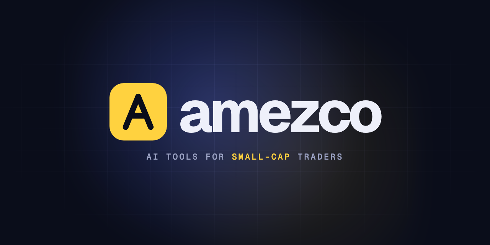

<p align="center">
  <a href="https://amezco.app"></a>
</p>

<p align="center">
  <a href="https://amezco.app"><b>amezco.app</b></a> ·
  <a href="https://github.com/Amezco-Group-LLC/sekd"><b>sekd</b></a> ·
  <a href="mailto:contact@amezco.app"><b>contact@amezco.app</b></a>
</p>

---

**Amezco Group LLC** builds AI tools for traders in U.S. small-cap stocks. We read SEC filings so you can spot dilution before it hits the tape, run trading infrastructure like production systems, and turn trade history into answers.

We're bootstrapped, we trade this market ourselves, and every tool here started as something we needed.

## Open source

### [sekd](https://github.com/Amezco-Group-LLC/sekd): SEC Decoded

Day-trading due diligence in your terminal. Give it a ticker and it pulls filing history and XBRL facts from SEC EDGAR, scores dilution risk, and (with `--deep`) uses an LLM to extract shelf capacity, ATM room, warrants and convertibles straight from S-3, 424B and 10-Q filings.

```bash
brew tap amezco-group-llc/sekd
brew install sekd

sekd report SOUN          # full due diligence report
sekd report SOUN --deep   # + shelf, ATM, warrants and convertibles from the filings
```

## Products

| | Product | What it does | Status |
|---|---|---|---|
| 📡 | **Amezco Filings** | Dilution radar: scores every small cap from 0 to 100 using S-1, S-3, 424B, ATM, warrant and convertible filings, with a link to the paragraph behind each score | Early access |
| ⚙️ | **Amezco Execution** | Managed trading stack on AWS: Windows + DAS Trader Pro, your bots, monitoring and locate routing | By application |
| 📊 | **Amezco Journal** | Trade journal analytics: which setups pay, which ones bleed, and the patterns that repeat | In development |

**Want early access?** Join the waitlist at [amezco.app](https://amezco.app/#waitlist).

## How we build

- **Primary sources first.** SEC filings are the record; every number should trace back to one.
- **AI reads, people verify.** LLMs extract terms at scale; structured EDGAR/XBRL data checks them.
- **Run like production.** Infrastructure as code, monitoring, tested recovery.
- **Information, not advice.** We build data and software. We don't recommend securities or manage money.

---

<sub>Amezco Group LLC is not a registered broker-dealer or investment adviser. Nothing in our repositories or products is investment advice. Trading small-cap stocks carries a high risk of loss.</sub>
